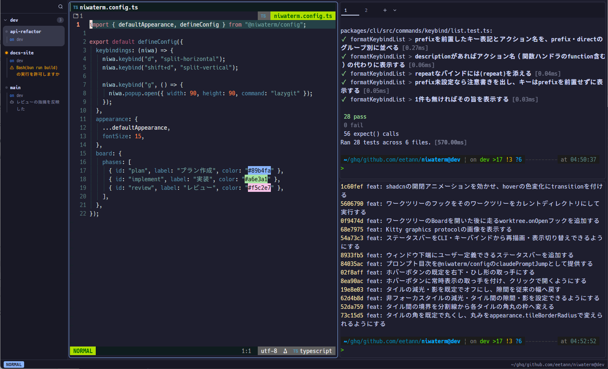

<!--
このREADMEはです・ます調で書く。
リポジトリを初めて訪れた人が最初に読む入口なので、丁寧な文体にしている。
ドキュメントサイトや docs/ は「〜する」「〜できる」の常体のままでよい（docs/brand/brand-guide.md）。
-->

<p align="center">
  <picture>
    <source media="(prefers-color-scheme: dark)" srcset="docs/brand/logo-dark.svg">
    
  </picture>
</p>

<h1 align="center">niwaterm</h1>

<p align="center">設定をTypeScriptで書き、キーバインドや画面の部品まで作り込めるターミナル</p>

niwaterm（にわたーむ）は、ターミナルとマルチプレクサとワークスペース管理を1つにまとめたデスクトップアプリです。キーバインド・ステータスバー・サイドバーの表示まで、設定ファイルに関数で書けます。画面分割・ワークスペース・内蔵ブラウザも最初から入っています。



## できること

- **TypeScriptで書く設定** — キーバインドにはアクション名のほか関数も渡せます。保存すると再起動なしで反映されます（[キーバインド](https://eetann.github.io/niwaterm/keybindings/)）
- **画面の部品をコードで足せる** — ステータスバー・タブの端のボタン・サイドバーのHTMLを関数で書けます（[ホバーボタン](https://eetann.github.io/niwaterm/hover-buttons/)）
- **CLIからすべて操作できる** — 画面の分割、タブへのキー送信、ブラウザのスクリーンショットまで`niwa`コマンドで行えます。スクリプトやAIエージェントからも呼べます（[CLIからの操作](https://eetann.github.io/niwaterm/cli/)）
- **AIエージェントの状態が見える** — Claude Code・Codex CLIの作業中・承認待ちがサイドバーに出ます（[AIエージェント連携](https://eetann.github.io/niwaterm/agents/)）
- **内蔵ブラウザとHTMLのUI** — 分割した画面の中でWebページを開けます。自作のHTMLをサイドバーやタブに置くこともできます（[ブラウザタブ](https://eetann.github.io/niwaterm/browser/)）
- **画面分割・ワークスペース・ポップアップ** — lazygitのようなTUIは、ポップアップで画面に重ねて開けます（[ワークスペースとBoard](https://eetann.github.io/niwaterm/boards/)）

## 動作環境

macOSとWindows（x64）で動きます。インストーラーなどの配布物はまだ無いため、ソースからビルドして起動してください。

## はじめかた

1. [インストール](https://eetann.github.io/niwaterm/installation/)の手順でビルドして起動します
2. [セットアップ](https://eetann.github.io/niwaterm/getting-started/)で`niwa`コマンドを使えるようにし、設定ファイルを作ります

## ドキュメント

使い方はドキュメントサイト（https://eetann.github.io/niwaterm/ ）にまとめています。CLIを入れたあとはターミナルでも読めます。

```sh
niwa docs list
niwa docs show concepts
```

## 謝辞

ターミナルの解析には[Ghostty](https://github.com/ghostty-org/ghostty)のlibghostty-vtを、デスクトップアプリの枠組みには[Electrobun](https://github.com/blackboardsh/electrobun)を使っています。

## ライセンス

[MIT](LICENSE)
