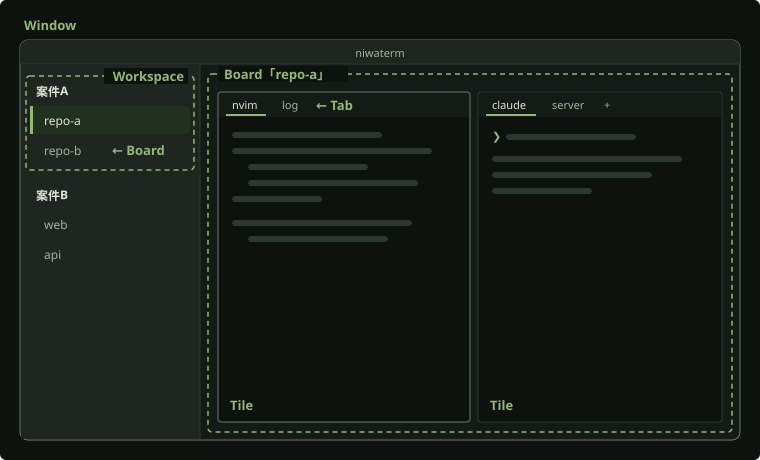

niwatermの画面は、Window・Workspace・Board・Tile・Tabの5つの階層でできている。設定ファイルの関数やCLIのコマンドもこの名前で対象を指すので、先に全体をつかんでおくと他のページが読みやすくなる。



```
Window（OSのウィンドウ）
└─ Workspace（案件・プロジェクトのまとまり）
   └─ Board（リポジトリやワークツリーごとの画面1枚）
      └─ Tile（画面を分割した1区画）
         └─ Tab（タイルの中で切り替えるもの。ターミナル・ブラウザなど）
```

## 各階層の役割

以下で「prefix」と書いたキーは、prefixキー（既定は`ctrl+b`）を押して離したあとに押すキーを指す（[キーバインド](/niwaterm/keybindings/)）。

### Window

OSのウィンドウそのもの。起動時にはメインウィンドウが1枚開き、前回終了したときのワークスペース・Board・タイル・タブを復元する。prefix + `shift+w`（`niwaterm window new`）で開く2枚目以降は一時ウィンドウで、まっさらな状態で開き、閉じると何も残らない。ウィンドウをまたいでタブやBoardを移すことはできない。

### Workspace

案件やプロジェクト単位のまとまり。サイドバーに見出しとして並ぶ。prefix + `shift+n`（`niwaterm workspace new`）で作り、prefix + `]` / `[`で切り替える。サイドバーの見出しのクリックでも切り替えられる。

### Board

1つの案件の中で、リポジトリやgitのワークツリーごとに分けた画面1枚。サイドバーでワークスペースの見出しの下に並び、選ぶと右側のタイル配置がまるごと入れ替わる。tmuxのwindowにあたる。prefix + `c`（`niwaterm board new`）で作る。

Boardが1つしかないワークスペースでは、サイドバーのBoard行を省略して見出しだけを出す。Boardを使い分けない限り、Workspaceの下にすぐタイルが並んでいるように見える。Boardの名前の付き方や作業フェーズは[ワークスペースとBoard](/niwaterm/boards/)、ワークツリーをBoardとして開く方法は[ワークツリー](/niwaterm/worktrees/)で説明している。

### Tile

Boardを分割した1区画。prefix + `d`で左右、prefix + `shift+d`で上下に分割し、prefix + 矢印キーで隣のタイルへフォーカスを移す。prefix + `z`でフォーカス中のタイルだけを一時的に画面いっぱいに広げる。

### Tab

タイルの上端に並び、タイルの中で切り替える単位。ターミナルのほか、[ブラウザ](/niwaterm/browser/)や[カスタムビュー](/niwaterm/custom-views/)もタブとして開ける。prefix + `t`で新しいターミナルのタブ、prefix + `shift+t`でブラウザのタブを開き、prefix + `n` / `p`で切り替える。

タブを切り替えても、タイルの配置はそのままで、そのタイルに出る中身だけが変わる。裏に回ったタブのプロセスも動き続ける。エージェントを動かしているタイルの裏にログのタブを置いておく、といった使い方ができる。

## ポップアップ

タイルやタブとは別に、画面の上へ重ねて開く一時的な画面がある。lazygitやfzfのような単発の操作に使う。prefix + `` ` ``で開閉し、ワークスペースごとに1つだけ持てる。Boardを切り替えても同じポップアップが出る。操作は[基本のコマンド](/niwaterm/cli/commands/#ポップアップpopup)を参照。

## tmuxとの対応

tmuxと同じ名前でも指すものが違うので注意する。特にタブは、tmuxのwindowのように画面全体を切り替えるものではなく、タイルの中身だけを切り替える。画面全体を切り替えたいときはBoardかWorkspaceを使う。

| niwaterm  | tmux                                    |
| --------- | --------------------------------------- |
| Window    | ―（tmuxを動かしている端末のウィンドウ） |
| Workspace | session                                 |
| Board     | window                                  |
| Tile      | paneの位置                              |
| Tab       | pane（プロセスを持つものとして）        |

## CLIから構成を確かめる

`niwaterm list`を実行すると、いまのウィンドウの階層がIDつきで出る。CLIで操作対象を指定するときは、ここに出るIDを使う。

```
workspace-1 "dev" (active)
  tile-1 (focused)
    tab-1 "editor" (active)
    tab-2
  tile-2
    tab-3 "server" (active)
```

この例のようにBoardが1つだけのワークスペースでは、サイドバーと同じくBoardの行を省く。表示の詳しい読み方は[基本のコマンド](/niwaterm/cli/commands/#状態を確認するping--list)で説明している。
