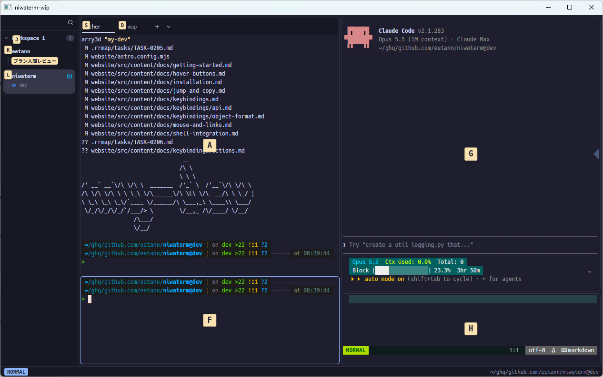

マウスを使わずに、キーボードだけで画面の中を移動する機能が3つある。

- **ジャンプヒント** — 見えているタイル・タブ・Boardへ、1〜2回キーを押すだけで移る
- **プロンプトジャンプ** — スクロールバックを、コマンド1つ分ずつ遡る
- **コピーモード** — キーボードで範囲を選んでコピーする

## ジャンプヒント

prefix + `f`で、移れる場所にラベルが重なって出る。ラベルの文字を打つと、その場所へ移る。方向キーを何度も押したり、サイドバーをクリックしたりしなくて済む。

ラベルが出るのは次の場所。

- タイル
- タブ
- サイドバーのBoardとワークスペース
- ポップアップ

やめるときは`Escape`を押す。

## プロンプトジャンプ（コマンド単位で遡る）

prefix + `shift+up` / `shift+down`で、1つ前 / 次のプロンプトへ飛ぶ。飛んだ先のプロンプトが画面の一番上に来るので、そのコマンドの出力を頭から読める。長いビルドログを遡って「どのコマンドの出力だったか」を探すときに、1ページずつスクロールしなくて済む。

使うには[シェル統合](/niwaterm/shell-integration/)が必要。シェル統合を入れていなくても、starshipやpowerlevel10kのようなプロンプトなら動くことがある。vimやlazygitのような全画面のアプリを表示しているあいだは、飛ぶ先がないので何も起きない。

コピーモードの中では、同じ操作を`{` / `}`で行う。カーソルは、コマンドを打った行に止まる。`V`で行を選んでから`}`を押すと、コマンドの行から次のコマンドの行までを選べる。出力だけが欲しいときは、最後に`k`で1行戻す。

## コピーモード（vi風のキーボード選択）

prefix + `v`でコピーモードに入る。vimのようなキー操作でスクロールバックを移動し、範囲を選んでコピーできる。コピーモードのあいだは新しい出力が来ても画面が流れないので、落ち着いて選べる。

コピーモードで押したキーはシェルには送られない。prefixキーを使った操作（タイルの移動など）は、コピーモードのままでもできる。

| キー                            | 動作                                                                                             |
| ------------------------------- | ------------------------------------------------------------------------------------------------ |
| `h` / `j` / `k` / `l`、矢印キー | カーソル移動                                                                                     |
| `w` / `b` / `e`                 | 単語単位の移動（次の単語の先頭 / 前の単語の先頭 / 単語の末尾）                                   |
| `0` / `^` / `$`                 | 行頭 / 行の最初の非空白 / 行の最後の非空白                                                       |
| `gg` / `G`                      | スクロールバックの先頭 / 最新行                                                                  |
| `ctrl+u` / `ctrl+d`             | 半画面ずつ上下へ                                                                                 |
| `pageup` / `pagedown`、`ctrl+f` | 1画面ずつ上下へ（`ctrl+f`は下だけ）                                                              |
| `H` / `M` / `L`                 | 画面の上端 / 中央 / 下端へ                                                                       |
| `/` / `?`                       | 下 / 上へ向かって検索する（打った文字がその場でハイライトされ、`Enter`で一致した場所へ飛ぶ）     |
| `n` / `N`                       | 直前の検索を同じ向き / 逆向きで繰り返す                                                          |
| `{` / `}`                       | 1つ前 / 次のプロンプトへ飛ぶ（[プロンプトジャンプ](#プロンプトジャンプコマンド単位で遡る)）      |
| `v` / `V`                       | 文字選択 / 行選択の開始・解除（選択中に押すと切り替え）                                          |
| `y`、`Enter`                    | 選択範囲をクリップボードへコピーしてコピーモードを抜ける（選択していなければカーソル行をコピー） |
| `Escape`                        | 選択中なら選択解除、選択していなければコピーモードを抜ける                                       |
| `q` / `ctrl+c`                  | コピーモードを抜ける                                                                             |

画面の幅で折り返された行は、コピーすると1行につながる。行末の空白は取り除かれる。

これらのキーは設定ファイルで変えられる（[コピーモードのキーを変える](/niwaterm/keybindings/#コピーモードのキーを変える)）。
